  

  <a href="https://www.linkedin.com/in/furkansaygin"><b>LinkedIn</b></a> /
  <a href="https://github.com/respected0?tab=repositories"><b>Repositories</b></a> /
  <a href="mailto:furkaans25@gmail.com"><b>Get in touch</b></a>

I'm **Furkan** 👾 — an embedded software developer from Türkiye. My day job lives close to the metal: **C**, microcontrollers and electronics. On the side I build **tools for AI coding agents**, mostly around one question: how do you make an agent remember what you already decided?

Everything here is built in the open, so feel free to read the code, open an issue or fork it.

## Start here

<table>
  <tr>
    <td width="50%" valign="top">
      01 / MEMORY
      <h3><a href="https://github.com/respected0/respected-brain">Respected Brain</a></h3>
      Shared memory for AI coding agents. Summarizes sessions into plain-Markdown notes in your own Obsidian-compatible vault, so Claude Code, Codex, Cursor and friends pick up where the last one left off.
        
      <a href="https://github.com/respected0/respected-brain"><b>Give your agents a memory →</b></a>
    </td>
    <td width="50%" valign="top">
      02 / ECOSYSTEM
      <h3><a href="https://github.com/respected0/respected-hub">Respected Hub</a> & <a href="https://github.com/respected0/respected-orchestrator">Orchestrator</a></h3>
      The pieces around Brain: a hub to set up and manage it in one place, and an orchestrator for coordinating agent work across tools.
        
      <a href="https://github.com/respected0/respected-hub"><b>Open the hub →</b></a>
    </td>
  </tr>
  <tr>
    <td width="50%" valign="top">
      03 / TEAM PROJECT
      <h3><a href="https://github.com/respected0/personal-finance-project-hub">Personal Finance OS</a></h3>
      A personal finance platform with web, mobile and a ledger-grade backend. The public hub holds the architecture, release manifests and integration rules for the whole ecosystem.
        
      <a href="https://github.com/respected0/personal-finance-project-hub"><b>See the architecture →</b></a>
    </td>
    <td width="50%" valign="top">
      04 / DAY JOB
      <h3>Embedded systems</h3>
      Firmware in C, low-level drivers and the electronics underneath. The kind of code where every byte and every cycle counts — and the mindset I bring to everything else.
        
      <a href="https://www.linkedin.com/in/furkansaygin"><b>Work with me →</b></a>
    </td>
  </tr>
</table>

## On the workbench

**Respected Brain — beta.** Windows installer, no admin rights, no Python needed. Next up: verified macOS & Linux support and better local search.

[Read the docs](https://github.com/respected0/respected-brain/blob/main/docs/USAGE.md) · [Report an issue](https://github.com/respected0/respected-brain/issues)

## Toolbox

  
  
  
  
  
  

---

  <b>Close to the metal. Open in public.</b> 
  Questions, ideas or collaborations: <a href="mailto:furkaans25@gmail.com">furkaans25@gmail.com</a>

